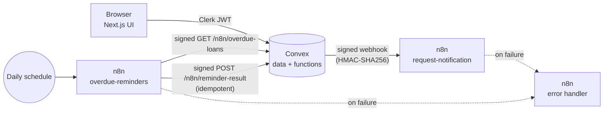

# LendLoop

> Borrow what you need. Lend what you don't.

A neighborhood tool-lending board. Neighbors list tools, request to borrow
them for a date range, and get automated notifications and overdue reminders
through **n8n**.

**Stack:** Next.js 15 (App Router) - Clerk - Convex - n8n (Docker) - TypeScript

## Contents

1. [Architecture](#architecture)
2. [What is implemented](#what-is-implemented)
3. [Local setup](#local-setup)
4. [Environment variables](#environment-variables)
5. [n8n workflows](#n8n-workflows)
6. [Security and data-minimization decisions](#security-and-data-minimization-decisions)
7. [Tests](#tests)
8. [What I would change for production](#what-i-would-change-for-production)

## Architecture



- **Next.js** only renders. It never decides who may do what.
- **Convex functions** hold all business rules and authorization. Identity
  comes from the Clerk JWT; the role is read from the `users` table on every
  call.
- **n8n** performs side effects (notifications, reminders). Convex and n8n
  authenticate each other with a shared HMAC secret in both directions.

```
app/                  Next.js pages (public page, dashboard + views)
convex/               schema, functions, HTTP endpoints, HMAC + auth helpers
  lib/auth.ts         requireUser / requireAdmin
  lib/hmac.ts         HMAC-SHA256 signing + verification (replay-protected)
  automation.ts       outgoing webhook, retries, idempotent event log
  http.ts             endpoints called by n8n (signature required)
  dev.ts              demo seed (disabled unless ALLOW_SEED=true)
n8n/workflows/        exported workflows (no secrets inside)
tests/                RBAC + integration tests (convex-test + vitest)
scripts/              webhook smoke test
docker-compose.yml    local n8n
```

## What is implemented

**Public page** - company name, tagline, read-only list of available tools
(name and category only, from Convex) and a "Sign in to lend or borrow"
button wired to Clerk.

**Authenticated experience** - list a tool (name, category, condition,
description), request to borrow for a date range, approve / decline requests
on your own tools, mark a loan as returned. Views: all tools with availability
(filterable by category), My listings, My requests, Incoming requests.

**Roles** (enforced in Convex functions, not only in the UI):

| Action | user | admin |
|---|---|---|
| Create a listing | yes | yes |
| Edit a listing | own only | own only (admins can remove, not edit others') |
| Delete a listing | own only | any |
| Request a tool | yes (not their own) | yes |
| Approve / decline a request | lender only | no |
| Mark a loan returned | lender | any loan |
| View all loans | no | yes |
| Mark a "Trusted Lender" | no | yes |

**Automation (n8n)** - two workflows plus an error workflow, see below.
Bonus: each loan shows its latest automation activity ("Reminder sent 2 days
ago", "Notification failed ...").

**Business rules** - no borrowing your own tool, no overlapping approved
loans, loans limited to 30 days, no start date in the past, one pending request
per person and tool, a tool on loan cannot be deleted.

## Local setup

Requirements: Node 20+, Docker, a free [Clerk](https://clerk.com) application.
A Convex account is optional for a first run (see step 2).

### 1. Install

```bash
npm install
cp .env.example .env.local   # Next.js variables (Clerk keys, Convex URL)
cp .env.example .env         # n8n / docker compose variables
```

### 2. Convex

```bash
npx convex dev
```

This creates (or links) a deployment, writes `NEXT_PUBLIC_CONVEX_URL` to
`.env.local` and keeps your functions in sync. Without an account you can use
a local anonymous deployment: `CONVEX_AGENT_MODE=anonymous npx convex dev`.

### 3. Clerk

1. Create a Clerk application and copy the publishable and secret keys into
   `.env.local`.
2. In Clerk, activate the **Convex integration** (Integrations -> Convex). On
   older Clerk instances, create a JWT template named **`convex`** with the
   Convex preset instead.
3. In Clerk -> **Sessions -> Customize session token**, keep `aud` and add the
   user's name and email, otherwise users show up as "Neighbor" with no email:

```json
{
  "aud": "convex",
  "email": "{{user.primary_email_address}}",
  "name": "{{user.full_name}}"
}
```

4. Copy the **Issuer** (Clerk Frontend API URL) and set it on Convex:

```bash
npx convex env set CLERK_JWT_ISSUER_DOMAIN https://<your-instance>.clerk.accounts.dev
```

### 4. Shared secret and n8n

```bash
# one long random value, used by BOTH sides
openssl rand -hex 32
```

Put it in `.env` as `LENDLOOP_SHARED_SECRET`, set `CONVEX_SITE_URL` (the
`.convex.site` URL) and `N8N_ENCRYPTION_KEY`, then:

```bash
npx convex env set N8N_WEBHOOK_SECRET <same secret>
npx convex env set N8N_WEBHOOK_URL http://localhost:5678/webhook/lendloop-request-events
docker compose up -d
```

Import and publish the workflows (the error workflow first):

```bash
docker compose exec n8n n8n import:workflow --separate --input=/workflows
for id in lendlpErrHandler1 lendlpNotify0001 lendlpReminders1; do
  docker compose exec n8n n8n publish:workflow --id=$id
done
docker compose restart n8n
```

Open <http://localhost:5678> to create the n8n owner account and inspect runs.

> Convex running in the cloud cannot reach `localhost`. Expose n8n with a
> tunnel (for example `cloudflared` or `ngrok`) and use that URL as
> `N8N_WEBHOOK_URL`. A Convex dev deployment running locally can use
> `http://localhost:5678/...` directly. In both cases n8n needs to reach
> Convex HTTP actions through `CONVEX_SITE_URL`
> (`http://host.docker.internal:3211` for a local anonymous deployment).

### 5. Run the app and create the first admin

```bash
npm run dev
```

Sign in once, then promote yourself from the CLI (internal functions cannot be
called from the browser):

```bash
npx convex run users:setRoleByEmail '{"email":"you@example.com","role":"admin"}'
```

### Try the automation without signing in

```bash
npx convex env set ALLOW_SEED true
npx convex run dev:seed                      # demo users, tools, a pending and an overdue loan
set -a; . ./.env; set +a
node scripts/test-n8n-webhook.mjs            # 6 checks against the webhook (valid, duplicate, tampered, ...)
docker compose run --rm --no-deps -e N8N_RUNNERS_BROKER_PORT=5680 n8n execute --id=lendlpReminders1
npx convex data automationEvents             # the reminder was recorded once
```

## Environment variables

| Name | Where | Purpose |
|---|---|---|
| `NEXT_PUBLIC_CLERK_PUBLISHABLE_KEY`, `CLERK_SECRET_KEY` | `.env.local` | Clerk |
| `NEXT_PUBLIC_CONVEX_URL` | `.env.local` | Written by `convex dev` |
| `CLERK_JWT_ISSUER_DOMAIN` | Convex env | Validates Clerk tokens |
| `N8N_WEBHOOK_URL` | Convex env | Where Convex sends events |
| `N8N_WEBHOOK_SECRET` | Convex env | HMAC secret (same as `LENDLOOP_SHARED_SECRET`) |
| `ALLOW_SEED` | Convex env | Enables `dev:seed` (never in production) |
| `LENDLOOP_SHARED_SECRET` | `.env` -> n8n | HMAC secret, read with `$env` in Code nodes |
| `CONVEX_SITE_URL` | `.env` -> n8n | Convex HTTP actions base URL |
| `N8N_ENCRYPTION_KEY` | `.env` -> n8n | Encrypts n8n's stored credentials |

Secrets live in environment variables only. `.env*` is git-ignored and the
exported workflow JSON contains no secret (verified: they reference
`$env.LENDLOOP_SHARED_SECRET`).

## n8n workflows

All three are in `n8n/workflows/`.

**1. Request notification** (`request-notification.json`)
Convex calls the webhook when a request is created (notifies the lender) or
changes status (notifies the borrower). Steps: verify HMAC on the **raw body**
-> reject with `401` if invalid or older than 5 minutes -> skip duplicates by
`eventId` -> send a notification (a logged mock; swap in Email/Slack/Discord)
-> respond `200`.

**2. Overdue reminders** (`overdue-reminders.json`)
Runs daily at 09:00 UTC. Signs a `GET /n8n/overdue-loans` request, sends one
reminder per overdue loan, then writes each result back with a signed
`POST /n8n/reminder-result`. HTTP nodes retry 3 times. A "Run now" trigger is
included for testing.

**3. Error handler** (`error-handler.json`)
Set as the error workflow of the two above. Any failed run raises an alert
(logged; replace with a real channel in production). It is never silent.

### Signature format (both directions)

```
signature = HMAC_SHA256(secret, `${timestamp}.${METHOD}.${pathname}.${rawBody}`)  // hex
headers:  x-lendloop-timestamp, x-lendloop-signature, x-lendloop-event-id
```

Binding the method and path prevents replaying a signature on another
endpoint; the timestamp window (5 minutes) limits replay in time.

## Security and data-minimization decisions

- **Authorization lives in Convex.** Every mutation/query calls `requireUser`
  or `requireAdmin` and re-checks ownership. The UI hides buttons for
  convenience only.
- **The role is never client-controlled.** It is stored in the `users` table,
  created as `user` on first login, and only changeable by an admin-restricted
  mutation or an internal CLI function. Not read from the JWT or from arguments.
- **Public data is minimal.** `tools.listPublic` returns only `name` and
  `category` of available tools. No ids, owners, descriptions or loan data.
  Signed-in users see a "Trusted Lender" flag, not the owner's identity.
- **n8n receives only what it needs.** The notification payload contains the
  recipient's name and email, the tool name and the dates. The overdue endpoint
  returns the same minimum. No descriptions, roles, ids of other people.
- **HMAC in both directions**, constant-time comparison, replay window, and one
  generic `401` for every failure (no oracle).
- **Idempotent writes.** `automationEvents.idempotencyKey` is unique per event
  (`loan-event:<loan>:<event>` and `reminder:<loan>:<date>`). Replays are
  no-ops and a recorded "sent" is final.
- **Failures are visible.** Convex retries the webhook with exponential
  backoff (5 attempts), records `pending` / `failed` with the reason, and shows
  it on the loan. n8n has an error workflow.
- **Validation** on the server for text lengths, dates, ranges and ids that
  come from outside (`normalizeId`).
- **Secrets** only in environment variables / n8n environment, never in code or
  in exported workflows. The n8n editor port is bound to `127.0.0.1`.
- **Security headers** (`nosniff`, `X-Frame-Options`, `Referrer-Policy`,
  `Permissions-Policy`) set in `next.config.ts`.

## Tests

```bash
npm test            # 26 tests: RBAC, validation, HMAC, HTTP endpoints, retries, idempotency
npm run typecheck
```

`tests/rbac.test.ts` proves the rules above server-side by calling the Convex
functions with different identities (anonymous, user, other user, admin).
`tests/integration.test.ts` covers signature verification (tampering, wrong
path/method, stale timestamp), the n8n endpoints, the write-back idempotency,
and the retry/give-up behavior of the outgoing webhook.

I also checked the tests are meaningful by temporarily removing the lender
check and the signature check: the matching tests failed, then passed again
once restored. The two n8n workflows were run against a real n8n 2.46.6
container (webhook accept/reject cases and a full reminder run with write-back).

What is **not** covered by automated tests: the React UI and the live Clerk
sign-in flow (they need real Clerk keys).

## What I would change for production

1. **Real notification channel.** Replace the mock Code nodes with an email
   provider (or Slack/Discord), using n8n credentials, and handle bounces.
2. **Admin bootstrap and management.** Replace the CLI promotion with an
   audited admin process, and add an audit log of admin actions
   (removals, Trusted Lender changes).
3. **Secrets management.** Rotate the shared secret regularly, support two
   active secrets during rotation, and keep secrets in a manager (not `.env`).
4. **Hardened n8n.** External task runners, queue mode with Postgres, a
   reverse proxy with TLS, SSO or at least 2FA on the editor, locked-down
   network access, backups of the n8n database, and execution-data pruning.
5. **Delivery guarantees.** Use an outbox with a dead-letter queue and an
   alert when a notification stays `failed`, rather than relying only on the
   scheduler retry.
6. **Privacy.** Store as little personal data as possible: a data-retention
   policy for finished loans, user data export/deletion, and avoid sending
   email addresses to n8n by sending a user id and letting n8n resolve it
   through an authenticated endpoint.
7. **Abuse and limits.** Rate limiting on mutations and on the HTTP endpoints,
   pagination on lists, and moderation of listings.
8. **Observability.** Sentry for the app, structured logs and alerting on
   automation failures, and uptime checks on the webhook.
9. **Browser security.** A strict Content-Security-Policy and an end-to-end
   test suite (Playwright) for the main flows.
10. **CI/CD.** Run `typecheck`, tests and a dependency audit on every PR,
    deploy Convex and Next.js separately per environment, and validate the n8n
    workflow JSON in CI.
11. **Healthcare-style context.** For regulated data: encryption at rest and in
    transit, field-level minimization (already the pattern here), a complete
    audit trail of reads and writes, strict role scoping, and a signed
    data-processing agreement with every sub-processor (including the
    automation platform).
